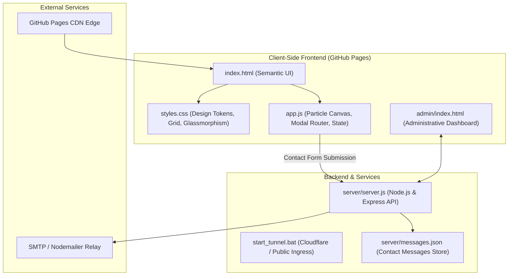

# Hitesh V S — Personal Portfolio Website

<p align="center">
  <a href="https://hitesh070.github.io">
    
  </a>
  
  
  
</p>

The official engineering portfolio and personal website of **Hitesh V S**, engineer specializing in Electrical and Electronics Engineering (EEE).

The website showcases interdisciplinary engineering projects spanning **Embedded Systems**, **Digital VLSI Design**, **Power Electronics**, **Control Systems**, **Software Development**, peer-reviewed research publications, and intellectual property / patent filings.

---

## Table of Contents
- [Overview & Architecture](#overview--architecture)
- [Key Features & Functional Highlights](#key-features--functional-highlights)
- [Technical Stack](#technical-stack)
- [Repository Structure](#repository-structure)
- [Local Setup & Development](#local-setup--development)
  - [1. Static Frontend Launch](#1-static-frontend-launch)
  - [2. Node.js Contact Server (Optional)](#2-nodejs-contact-server-optional)
- [Admin Management Portal](#admin-management-portal)
- [Author & Contact Information](#author--contact-information)
- [License](#license)

---

## Overview & Architecture

The website is engineered with pure, standard web technologies (HTML5, Vanilla CSS3, ES6+ JavaScript) without heavy runtime frameworks, ensuring instantaneous load times, optimal SEO scoring, 60fps animations, and responsive mobile-first typography.



---

## Key Features & Functional Highlights

- **Featured Engineering Projects Showcase**: Deep-dive showcases covering:
  - *Autonomous Aquatic Waste Mapping Catamaran Vessel* (Marine Robotics / YOLOv8 / PID)
  - *Cascade (Dual-Loop) Soft-Clamped Buck Converter* (Power Electronics / 12V to 5V)
  - *MSB-Triggered ETA-1 Approximate Arithmetic Adder* (VLSI 45nm CMOS / Edge AI)
  - *Smart Automatic Irrigation & Foliage Misting System* (NI LabVIEW / Analog LM358/LM393)
  - *UAV Guardian Security Drones* & *HI Grid Solar Power System Simulator*
- **Interactive Technical Modals**: Architectural schematics, mathematical transfer functions, hardware specifications, and live simulation links for each project.
- **Scholarly Inquiry & Intellectual Property**: Highlighted portfolio section indexing research paper manuscripts, journal submissions, and patent documentation.
- **Interactive Ambient Particle Canvas**: Custom multi-layer particle mesh rendering organic background motion via the HTML5 Canvas API with zero external dependencies.
- **Administrative Portal (`/admin`)**: Dedicated dashboard for monitoring contact form submissions, message logs, and visitor interactions.
- **Node.js Express Contact Backend (`/server`)**: Modular API handling contact submissions with rate limiting, input sanitization, and email notifications.

---

## Technical Stack

| Layer | Technology |
| :--- | :--- |
| **Markup & Semantics** | HTML5 (Strict Semantic Tags, OpenGraph Meta Tags) |
| **Styling & Design System** | Modern Vanilla CSS3 (Custom CSS Properties, Grid, Flexbox, Glassmorphism) |
| **Client Scripting** | Vanilla JavaScript (ES6+ Modules, Async/Await, IntersectionObserver) |
| **Interactive Graphics** | HTML5 Canvas API (Particle Field Engine), Inline SVGs |
| **Typography & Icons** | Google Fonts (*Plus Jakarta Sans*, *Outfit*, *Fira Code*), FontAwesome v6 |
| **Backend & Mailer** | Node.js, Express, Nodemailer, CORS Middleware |
| **Hosting & Deployment** | GitHub Pages (Production Edge CDN) |

---

## Repository Structure

```text
├── index.html                       # Primary portfolio homepage & semantic layout
├── styles.css                       # Global design system tokens, themes & animations
├── app.js                           # Core application engine, canvas mesh, modal dialogs
├── start_tunnel.bat                 # Utility script to expose contact server via tunnel
├── LICENSE                          # MIT License File
├── README.md                        # Master repository documentation
│
├── admin/                           # Administrative Control Panel
│   ├── index.html                   # Admin dashboard layout
│   ├── admin.css                    # Admin-specific stylesheet
│   └── admin.js                     # Message reader & dashboard controller
│
├── assets/                          # Photographic and vector media assets
│   ├── hero.jpg                     # High-resolution profile portrait
│   ├── og_banner.svg                # Social share preview card
│   ├── Hitesh_VS_Resume.pdf         # Downloadable curriculum vitae (CV)
│   ├── vit_logo.png                 # Institutional emblem logo
│   ├── ieee_sscs.png                # IEEE SSCS society emblem
│   ├── robotics_club.png            # Robotics Club emblem
│   ├── santiniketan_logo.png        # Alma mater emblem
│   ├── little_kingdom_logo.png      # Alma mater emblem
│   ├── uav_guardian.png             # UAV project schematic diagram
│   └── project1.jpg - project6.jpg  # Project showcase media banners
│
└── server/                          # Contact Form Backend Service
    ├── server.js                    # Node.js Express REST API server
    ├── package.json                 # Node package configuration & dependencies
    ├── package-lock.json            # Deterministic dependency tree lockfile
    ├── config.example.json          # Template environment and mail credentials
    └── README.md                    # Server deployment & configuration guide
```

---

## Local Setup & Development

### 1. Static Frontend Launch
Clone the repository and serve locally using any standard static HTTP server:
```bash
git clone https://github.com/Hitesh070/Hitesh070.github.io.git
cd Hitesh070.github.io

# Launch using Python built-in HTTP server:
python -m http.server 8000
```
Open `http://localhost:8000` in your web browser.

### 2. Node.js Contact Server (Optional)
To run the local backend server for processing contact form submissions:
```bash
cd server
npm install
cp config.example.json config.json   # Configure your SMTP credentials
npm start
```
The server will bind to port `3000` by default.

---

## Admin Management Portal

To access the administrative dashboard locally:
1. Ensure the backend server in `server/` is running.
2. Navigate to `http://localhost:8000/admin/index.html`.
3. Review contact inquiries, export message records, or purge old logs.

---

## Author & Contact Information

- **Developer**: Hitesh V S
- **Email**: [hiteshvs616@gmail.com](mailto:hiteshvs616@gmail.com)
- **LinkedIn**: [linkedin.com/in/hiteshvs](https://www.linkedin.com/in/hiteshvs)
- **GitHub**: [@Hitesh070](https://github.com/Hitesh070)

---

## License

Released under the [MIT License](LICENSE). Copyright (c) 2025-2026 Hitesh V S.
