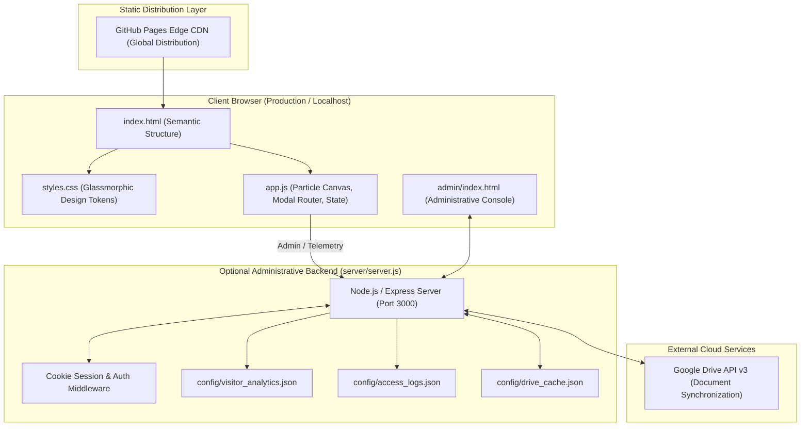
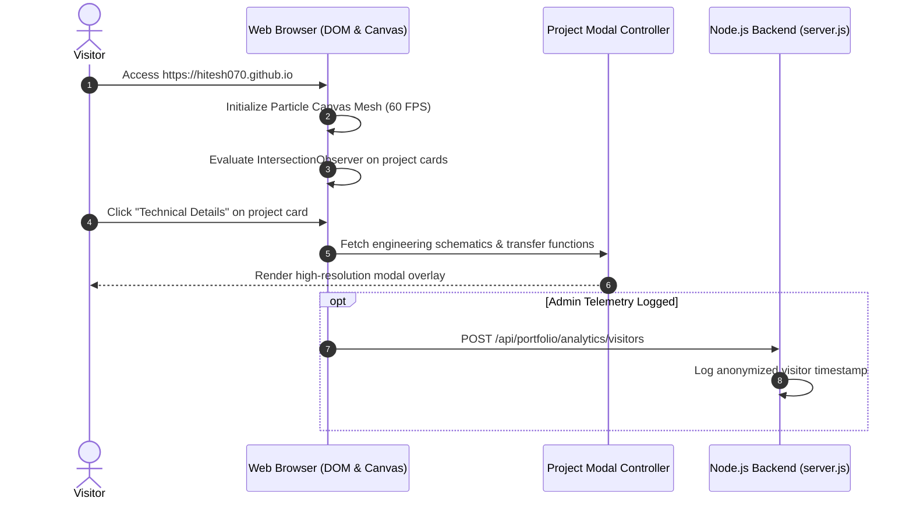

# Hitesh V S — Engineering Portfolio & Personal Website

<p align="center">
  <a href="https://hitesh070.github.io">
    
  </a>
  
  
  
</p>

The official engineering portfolio and personal web platform of **Hitesh V S**, specializing in Electrical and Electronics Engineering (EEE). Showcases interdisciplinary engineering projects spanning **Embedded Systems**, **Digital VLSI Design**, **Power Electronics**, **Marine Mechatronics**, **Control Systems**, **Spacecraft Orbital Telemetry**, and **Physics-Informed Deep Learning**.

---

## Table of Contents
- [1. Project Title & Overview](#1-project-title--overview)
- [2. Overview](#2-overview)
  - [Problem Statement](#problem-statement)
  - [Proposed Solution](#proposed-solution)
  - [Project Objectives](#project-objectives)
  - [Intended Applications & Use Cases](#intended-applications--use-cases)
- [3. Key Features](#3-key-features)
- [4. System Architecture](#4-system-architecture)
- [5. Technology Stack](#5-technology-stack)
- [6. Repository Structure](#6-repository-structure)
- [7. Hardware Requirements](#7-hardware-requirements)
- [8. Software Requirements](#8-software-requirements)
- [9. Installation and Setup](#9-installation-and-setup)
- [10. Usage Instructions](#10-usage-instructions)
- [11. System Workflow](#11-system-workflow)
- [12. API Documentation (Administrative Backend)](#12-api-documentation-administrative-backend)
- [13. Results and Demonstration](#13-results-and-demonstration)
- [14. Configuration](#14-configuration)
- [15. Troubleshooting](#15-troubleshooting)
- [16. Future Improvements](#16-future-improvements)
- [17. Contributing](#17-contributing)
- [18. License](#18-license)
- [19. Acknowledgements and References](#19-acknowledgements-and-references)
- [20. Author / Project Maintainer](#20-author--project-maintainer)

---

## 1. Project Title & Overview

**Hitesh070.github.io** serves as the central digital portfolio and technical showcase for Hitesh V S. Engineered using pure, dependency-free web technologies (semantic HTML5, vanilla CSS3, and ES6+ JavaScript), it delivers instantaneous load times, 60 FPS particle graphics, responsive mobile navigation, deep-dive project modals, and a modular Node.js/Express administrative backend.

---

## 2. Overview

### Problem Statement
Standard portfolio platforms and template site generators often introduce heavy JavaScript runtime overhead, cookie tracking, slow initial load times, and superficial summary cards that fail to convey rigorous engineering depth (such as transfer functions, circuit schematics, hardware pinouts, and mathematical models).

### Proposed Solution
This repository implements a lightweight, high-performance static website:
- **Zero-Framework Frontend**: Handcrafted Vanilla JavaScript and CSS custom properties providing clean animations, glassmorphism card elevation, and an interactive background canvas particle field without external framework dependencies.
- **Deep-Dive Technical Modals**: Structured technical overlays displaying full circuit schematics, mathematical transfer functions, hardware specifications, and live simulation links for each engineering project.
- **Administrative Control Panel (`/admin`)**: A secured Node.js Express server providing visitor analytics, system logs, administrative note taking, and Google Drive cloud storage synchronization.

### Project Objectives
- Achieve high Google Lighthouse performance (95+ across Performance, Accessibility, and Best Practices).
- Provide unified access to 9 core engineering projects, academic manuscripts, and patent documentation.
- Maintain responsive layout across all viewport breakpoints ($320\text{px}$ mobile to $4\text{K}$ monitors).

### Intended Applications & Use Cases
- Engineering portfolio presentation for academic admissions, industry recruitment, and research collaborations.
- Interactive showcase for peer-reviewed research publications and hardware prototypes.
- Central gateway for project documentation and live interactive web simulators.

---

## 3. Key Features

- **Comprehensive Engineering Portfolio**: Deep-dive project showcases featuring:
  - *Autonomous Aquatic Waste Mapping Catamaran Vessel* (Marine Robotics / YOLOv8 / 3-DOF Hydrodynamics / Closed-Loop PID)
  - *Cascade (Dual-Loop) Soft-Clamped Buck Converter* (Power Electronics / 12V to 5V / 10kHz ATmega328P ISR / Discrete PI)
  - *MSB-Triggered ETA-1 Approximate Arithmetic Adder* (Digital VLSI / 45nm CMOS / Edge AI FaceNet Biometrics)
  - *Smart Automatic Irrigation & Foliage Misting System* (NI LabVIEW / Dual NE556 / LM358 Buffer / LM393 Schmitt Trigger)
  - *Custom 3-Axis Motorized GoTo Telescope Mount* (60mm Refractor / PyQt6 Fluent / Next.js Web Bridge / Stellarium)
  - *ISRO Orbit Watch* (Electron 31 / React 18 / Three.js / SGP4 Ephemeris / NASA Blue Marble 3D Globe)
  - *HI Grid Solar Power System Simulator* (Hay-Davies POA / Sandia Cell Temp / Indian Discom Tariffs / 3D Raytracing)
  - *Lithium-Ion Battery Thermal Runaway Prediction* (Physics-Informed Deep Learning / PINN / BiLSTM-Attention / TCN / Transformer)
  - *UpliftEd Advance Online Learning System* (Web Speech AI Multilingual Translation / YOLOv8 Vision Moderation / CustomTkinter)
- **Interactive Ambient Canvas Particle Field**: Multi-layer procedural canvas mesh rendering organic background particle motion with dynamic mouse proximity repulsion.
- **Technical Modal Architecture**: Dynamic DOM overlays that render high-resolution architectural schematics and engineering specifications without page reloads.
- **Administrative Management Suite (`/admin`)**: Dedicated dashboard for monitoring visitor telemetry, system access logs, administrative notes, and Drive backups.

---

## 4. System Architecture



---

## 5. Technology Stack

### Programming Languages & Runtimes
- **HTML5**: Strict semantic markup, OpenGraph social card metadata.
- **CSS3**: Custom CSS variables, flexbox, grid, glassmorphism, responsive breakpoints.
- **JavaScript (ES6+)**: Vanilla asynchronous DOM controller, HTML5 Canvas API, IntersectionObserver.
- **Node.js (v18+)**: Modular administrative backend server.

### Frameworks & Libraries
- **Server**: Express.js, cookie-parser, multer, googleapis (Google Drive API v3).
- **Typography & Icons**: Google Fonts (*Plus Jakarta Sans*, *Outfit*, *Fira Code*), FontAwesome v6.

### Deployment & Hosting
- **Production Frontend**: GitHub Pages (Edge CDN).
- **Administrative Ingress**: Localhost or Cloudflare Tunnel (`start_tunnel.bat`).

---

## 6. Repository Structure

```text
Hitesh070.github.io/
├── index.html                       # Primary portfolio homepage & semantic layout
├── styles.css                       # Global design system tokens, themes & animations
├── app.js                           # Core application engine, canvas mesh, modal dialogs
├── start_tunnel.bat                 # Utility script to expose contact server via tunnel
├── LICENSE                          # MIT License File
├── README.md                        # Master repository documentation
│
├── admin/                           # Administrative Control Panel
│   ├── index.html                   # Admin dashboard layout
│   ├── admin.css                    # Admin-specific stylesheet
│   └── admin.js                     # Message reader & dashboard controller
│
├── assets/                          # Photographic, vector, and architectural diagram assets
│   ├── alps_diagram.png             # Aquatic waste mapping vessel architecture diagram
│   ├── approx_adder_diagram.png     # ETA-1 approximate adder gate logic schematic
│   ├── buck_converter_diagram.png   # Cascade buck converter dual-loop architecture
│   ├── buck_converter_circuit_block.png # Buck converter circuit block schematic
│   ├── goto_telescope_diagram.png   # GoTo telescope kinematics & electronics diagram
│   ├── goto_build_media.png         # Physical telescope build showcase
│   ├── goto_telescope_icon.png      # Custom GoTo Telescope Mount high-res icon
│   ├── irrigation_diagram.png       # Analog irrigation & misting block schematic
│   ├── learning_system_diagram.png  # UpliftEd online learning system dataflow
│   ├── solar_simulator_diagram.png  # HI Grid computational solar physics pipeline
│   ├── thermal_runaway_diagram.png  # Battery thermal runaway PINN architecture
│   ├── hero.jpg                     # High-resolution profile portrait
│   ├── og_banner.svg                # Social share preview card
│   ├── Hitesh_VS_Resume.pdf         # Downloadable curriculum vitae (CV)
│   ├── vit_logo.png                 # Institutional emblem logo
│   ├── ieee_sscs.png                # IEEE SSCS society emblem
│   ├── robotics_club.png            # Robotics Club emblem
│   ├── santiniketan_logo.png        # Alma mater emblem
│   ├── little_kingdom_logo.png      # Alma mater emblem
│   └── project1.jpg - project6.jpg  # Project showcase media banners
│
└── server/                          # Contact & Administrative Backend Service
    ├── server.js                    # Node.js Express REST API server
    ├── package.json                 # Node package configuration & dependencies
    ├── package-lock.json            # Deterministic dependency tree lockfile
    ├── config.example.json          # Template environment and mail credentials
    └── README.md                    # Server deployment & configuration guide
```

---

## 7. Hardware Requirements

*Not applicable.* The portfolio runs entirely within client web browsers across standard desktops, laptops, tablets, and smartphones.

---

## 8. Software Requirements

- **Client Web Browser**: Any modern browser (Google Chrome, Mozilla Firefox, Safari, Microsoft Edge).
- **Node.js (for `/server`)**: Node.js 18.x or 20.x with `npm`.
- **Python (Optional for local static testing)**: Python 3.10+ (for `python -m http.server`).

---

## 9. Installation and Setup

### 1. Static Portfolio Launch
```bash
git clone https://github.com/Hitesh070/Hitesh070.github.io.git
cd Hitesh070.github.io

# Launch using Python built-in HTTP server:
python -m http.server 8000
```
Open `http://localhost:8000` in your web browser.

### 2. Administrative Backend Setup (Optional)
```bash
cd server
npm install
cp config.example.json config.json   # Configure your admin credentials and Google Drive keys
npm start
```
The administrative server binds to port `3000` by default.

---

## 10. Usage Instructions

1. **Browsing Projects**: Scroll to the **Featured Projects** section. Click **Technical Details** on any project card to launch the comprehensive engineering modal.
2. **Accessing Live Simulators**: In each modal, click the direct simulator buttons to launch projects like *HI Grid Solar Simulator*, *ETA-1 Bit Simulator*, or *Web Irrigation Studio*.
3. **Admin Dashboard**: Navigate to `http://localhost:3000/admin` (when running `server/server.js`), authenticate with configured admin credentials, and review visitor traffic and system logs.

---

## 11. System Workflow



---

## 12. API Documentation (Administrative Backend)

When `server/server.js` is active:

| Endpoint | Method | Authentication | Description |
| :--- | :--- | :--- | :--- |
| `/api/auth/login` | `POST` | None | Authenticates admin user with session cookie |
| `/api/auth/me` | `GET` | Session Cookie | Verifies current administrative session |
| `/api/auth/logout` | `POST` | Session Cookie | Terminates administrative session |
| `/api/admin/logs` | `GET` | Session Cookie | Returns server access and visitor audit logs |
| `/api/admin/notes` | `GET` | Session Cookie | Retrieves administrative scratch notes |
| `/api/admin/notes` | `POST` | Session Cookie | Updates administrative scratch notes |
| `/api/drive/status`| `GET` | Session Cookie | Checks Google Drive OAuth2 connection status |
| `/api/drive/files` | `GET` | Session Cookie | Lists Google Drive documents and backup files |

---

## 13. Results and Demonstration

The `assets/` folder contains verified, high-resolution architectural diagrams rendered across project modals:
- `assets/alps_diagram.png`: Catamaran marine robotics architecture.
- `assets/approx_adder_diagram.png`: MSB-triggered approximate adder gate schematic.
- `assets/buck_converter_diagram.png`: Cascade dual-loop power converter block diagram.
- `assets/goto_telescope_diagram.png`: 3-axis motorized telescope kinematics and pinouts.
- `assets/solar_simulator_diagram.png`: HI Grid computational solar physics flow.
- `assets/thermal_runaway_diagram.png`: Physics-informed neural network battery architecture.

---

## 14. Configuration

Key backend parameters in `server/config.json`:

```json
{
  "port": 3000,
  "adminUsername": "admin",
  "adminPasswordHash": "<SHA256_HASH>",
  "googleDrive": {
    "clientId": "<CLIENT_ID>.apps.googleusercontent.com",
    "clientSecret": "<CLIENT_SECRET>",
    "redirectUri": "http://localhost:3000/oauth2callback"
  }
}
```

---

## 15. Troubleshooting

1. **CORS Refusal on Localhost**:
   - *Cause*: Attempting to access `server/` API from a different port without CORS headers.
   - *Fix*: The Express server includes CORS middleware configured for development. Ensure requests target `http://localhost:3000`.
2. **Google Drive OAuth Token Expired**:
   - *Cause*: Stale refresh token in `server/config/drive_tokens.json`.
   - *Fix*: Delete `drive_tokens.json` and re-authenticate via the `/admin` portal.
3. **Canvas Particle Mesh Stutter**:
   - *Cause*: High-DPI screen with excessive particle count on low-power devices.
   - *Fix*: `app.js` dynamically scales particle density based on device pixel ratio and window width.

---

## 16. Future Improvements

- [ ] **Dynamic Research Paper Viewer**: Built-in Markdown and PDF reader for academic publications.
- [ ] **Automated GitHub Activity Feed**: Dynamic real-time commit stream via GitHub REST API.
- [ ] **Dark / Light System Theme Toggle**: User-selectable design token switching.

---

## 17. Contributing

1. Fork the repository.
2. Create a feature branch: `git checkout -b feature/interactive-demo`.
3. Commit your changes: `git commit -m "feat: add interactive circuit visualizer"`.
4. Push to branch: `git push origin feature/interactive-demo`.
5. Open a Pull Request.

---

## 18. License

This project is licensed under the [MIT License](LICENSE).

---

## 19. Acknowledgements and References

- [Google Fonts](https://fonts.google.com/) for *Plus Jakarta Sans*, *Outfit*, and *Fira Code* typography.
- [FontAwesome](https://fontawesome.com/) for vector icon assets.
- [Express.js](https://expressjs.com/) for the backend server runtime.

---

## 20. Author / Project Maintainer

- **Developer**: Hitesh V S
- **Email**: [hiteshvs616@gmail.com](mailto:hiteshvs616@gmail.com)
- **LinkedIn**: [linkedin.com/in/hiteshvs](https://www.linkedin.com/in/hiteshvs)
- **GitHub**: [@Hitesh070](https://github.com/Hitesh070)
